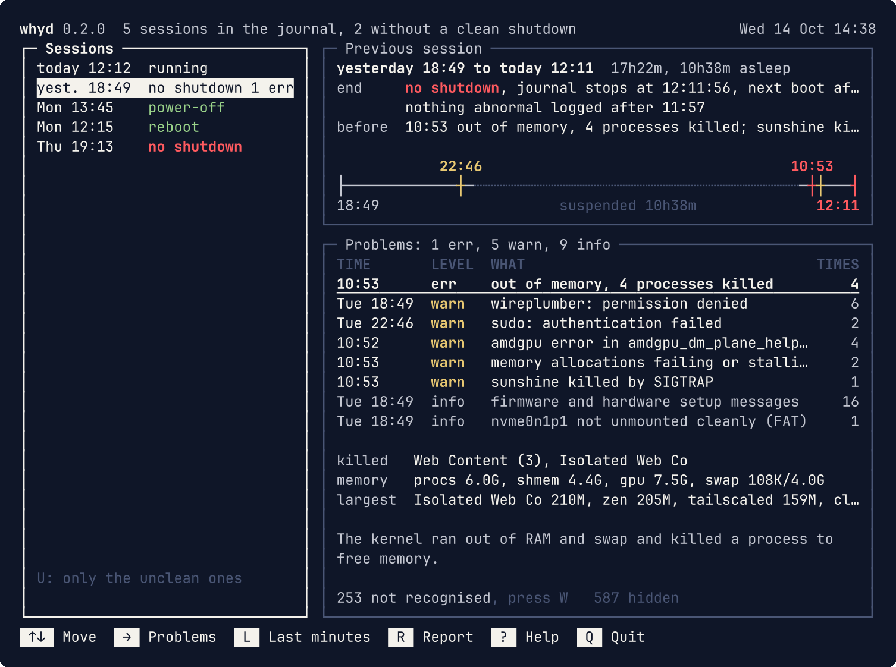
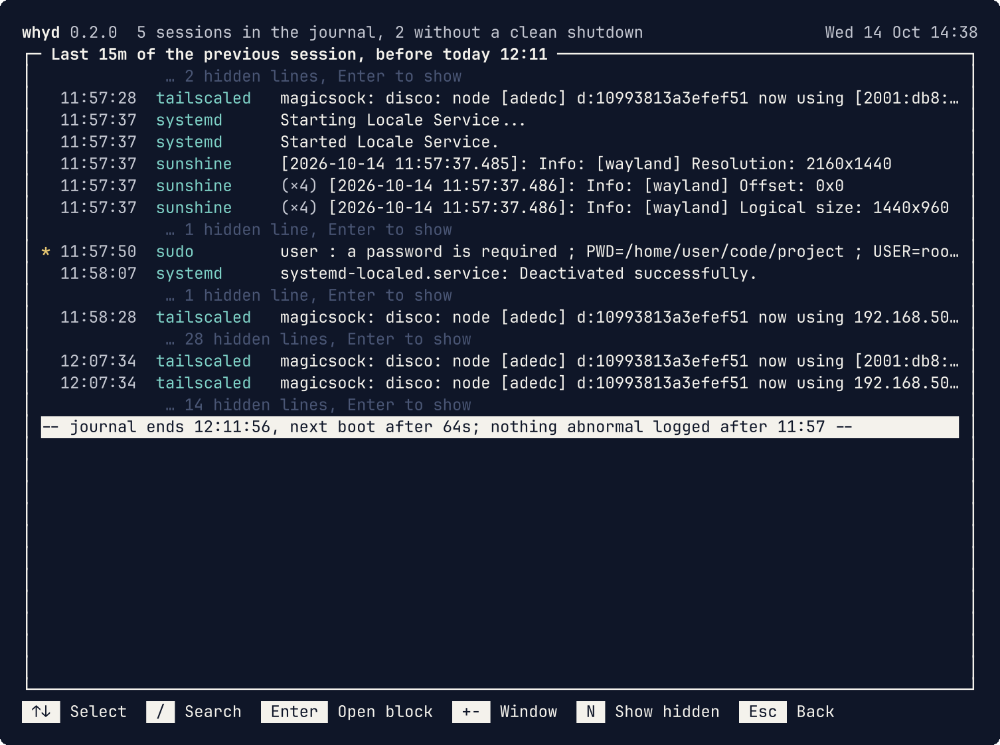
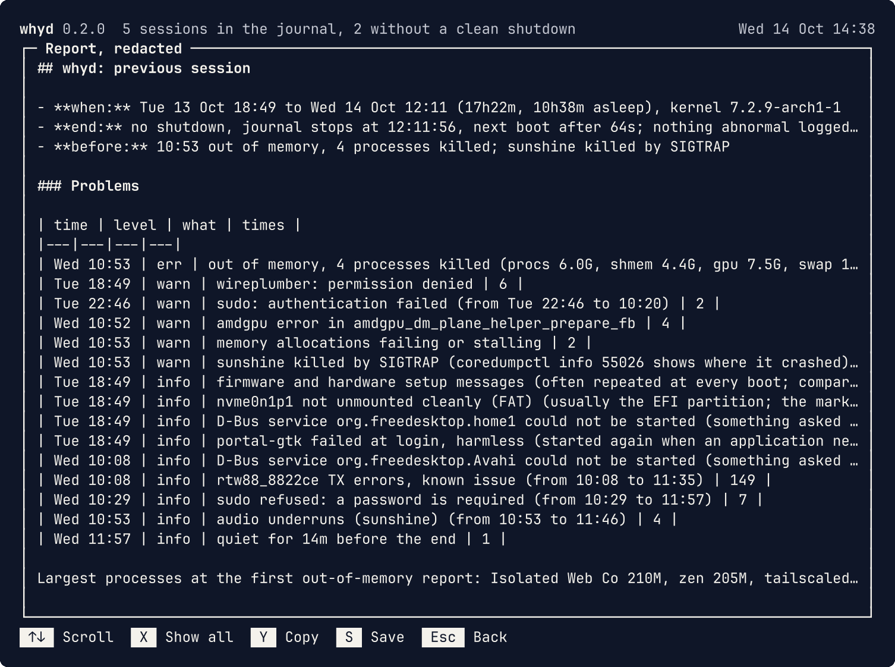

<div align="center">

<picture>
  <source media="(prefers-color-scheme: dark)" srcset="docs/logo/logo-dark.svg">
  
</picture>

**Why did my PC stop?**

[](https://github.com/vmaltarello/whyd/releases)
[](https://github.com/vmaltarello/whyd/actions/workflows/ci.yml)
[](go.mod)
[](LICENSE)
[](#install)

</div>

whyd reads the journal of the previous session and tells you, in one screen, how it ended and
what went wrong before.



Your laptop froze, you held the power button, it came back up. The answer is in the journal,
buried under thousands of harmless lines. whyd finds it:

- **how it ended**: clean power-off or reboot, hard power-off, died asleep, kernel panic
- **what went wrong before**: out-of-memory kills, GPU errors, crashes, failed services,
  hung tasks, overheating, disk errors, each with a short explanation
  ([the full list](docs/RULES.md#built-in-rules))
- **the last minutes** of the session, with the harmless lines folded away
- **a report** to paste on a forum, with addresses, hostname, user and Wi-Fi names removed

`journalctl -b -1 -p err` shows dozens of harmless errors, and nothing at all when the power
was cut: a hard power-off leaves no error behind. whyd tells the two apart, says how the
session ended, and explains each problem.

whyd only reads the journal: it doesn't go on the network, and on its own it writes nothing but
a small cache of the sessions already read, in `~/.cache/whyd`.

## Install

```sh
# any distribution: downloads the latest release, checks it, installs to /usr/local/bin
curl -fsSL https://raw.githubusercontent.com/vmaltarello/whyd/main/install.sh | sh

# Arch Linux and derivatives
curl -fLO https://github.com/vmaltarello/whyd/releases/latest/download/whyd_linux_amd64.pkg.tar.zst
sudo pacman -U ./whyd_linux_amd64.pkg.tar.zst

# Debian, Ubuntu and derivatives
curl -fLO https://github.com/vmaltarello/whyd/releases/latest/download/whyd_linux_amd64.deb
sudo apt install ./whyd_linux_amd64.deb

# Fedora (openSUSE: sudo zypper install with the same link)
sudo dnf install https://github.com/vmaltarello/whyd/releases/latest/download/whyd_linux_amd64.rpm

# from source, with Go 1.26 or newer
go install github.com/vmaltarello/whyd/cmd/whyd@latest
```

For ARM, replace `amd64` with `arm64`. Without sudo, the script installs to `~/.local/bin` with
`... | PREFIX=~/.local sh`; to update, run the same line again.

### Requirements

- Linux with systemd: whyd is a single program and needs only `journalctl`.
- A user in the `systemd-journal`, `adm` or `wheel` group (the first user usually is, on
  Ubuntu and Arch); otherwise run whyd with `sudo`.
- A journal kept on disk. If whyd finds only the current session even after a few reboots, the
  journal is kept in memory and lost at every shutdown: `sudo mkdir -p /var/log/journal` and
  reboot, and from then on whyd has the sessions to look at.

## Use

```
whyd                 the previous session, in the interface (as text in a pipe or a file)
whyd -b -3           another session (same numbers as journalctl -b; 1 is the oldest)
whyd report          a Markdown report, redacted, ready to paste
whyd --file F        a session recorded on another machine
                     (journalctl -b -1 -o json --all > F, - for stdin)
whyd rules           the rules in use, checked
```

In the interface the arrows do everything: ↑ ↓ move, → and ← switch panel, `Enter` opens a
problem's journal lines. `U` keeps only the sessions that didn't shut down cleanly, `L` shows
the last minutes, `R` the report, `?` every key.

<table>
<tr>
<td></td>
<td></td>
</tr>
<tr>
<td align="center">The last minutes</td>
<td align="center">The report</td>
</tr>
</table>

## Rules

Problems are recognised by rules written in TOML, not code. Your own go in
`~/.config/whyd/rules/` and can add to, change or turn off the built-in ones. Found a problem
whyd didn't recognise? A rule with a real example line is the best contribution:
[docs/RULES.md](docs/RULES.md) explains the format step by step, and
[CONTRIBUTING.md](CONTRIBUTING.md) how to build, test and send changes.

## License

[GPL-3.0-or-later](LICENSE)
